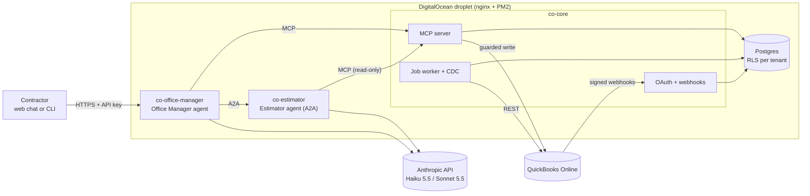

# Contractor Ops Agent

A contractor asks questions about their real QuickBooks books in plain English,
and drafts estimates from their own past jobs, through two cooperating AI
agents. Built in a week as a production-minded portfolio project.

**Live demo:** https://contractor-ops.houghworks.com (API key on request) · **Demo video:** _link_

> **"Which customers owe me more than 60 days?"** One tool call, answered from a
> local mirror of QuickBooks, with the 60-vs-61-day boundary handled exactly. About $0.0005.
>
> **"Draft an estimate for a bathroom remodel for Mark Johnson."** The Office Manager
> delegates to an Estimator agent over A2A. The Estimator sizes the job from comparable past
> jobs, with its assumptions stated. The Office Manager shows a preview and writes to
> QuickBooks only after an explicit "yes", exactly once. About $0.09 across both agents.

## Architecture



More diagrams (estimate sequence, sync pipeline, security model): [`docs/architecture.md`](docs/architecture.md).

## What this proves

| Requirement | How it's met here | Evidence |
|---|---|---|
| **Production AI agents with tool calling** | Two agents on a custom, inspectable loop (no framework). Every model call, tool call, A2A delegation and guard decision is a row in `agent_steps`. Model routing: Haiku 5.5 for classification and lookups, Sonnet 5.5 for analysis and estimating. | `packages/agent`, live traces in the web chat |
| **MCP** | MCP server on the 2026-07-28 spec (TypeScript SDK v2, stateless, StreamableHTTP): six tools, typed errors with codes and hints, a two-step guarded write. | `apps/mcp`, 30+ tests driving a real MCP client over HTTP |
| **A2A** | The Estimator is an A2A v1.0 server (official `@a2a-js/sdk`): Agent Card, Bearer auth, JSON-RPC, tasks in Postgres. The Office Manager discovers it from the card and delegates estimating to it. | `apps/estimator`, cross-agent cost query |
| **OAuth** | Signed connect links, single-use state, AES-256-GCM token storage bound to tenant and realm, refresh under a row lock so concurrent callers refresh once; `invalid_grant` marks the connection for re-auth. | `tokens.db.test.ts` |
| **Webhooks: retries, duplicate prevention, partial-failure recovery** | Signature verified on raw bytes; raw deliveries stored before parsing; events deduped on id and enqueued in the same transaction; version-guarded upserts make duplicates and reordering harmless; jittered backoff, dead letters with replay, stale-lock reaping; nightly CDC reconcile with fallbacks for CDC's 1,000-object and 30-day limits. | `webhook-flow.db.test.ts`, live webhook recovery (see failure modes) |
| **AI evals** | 36 cases × 3 iterations against real models in a hermetic seeded world: lookups, calculations, refusals, ambiguity, estimate quality, write safety, fault injection. Accuracy, variance, tool-call correctness, cost per case, categorized failure modes. | [`docs/eval-report.md`](docs/eval-report.md) |
| **Per-customer cost tracking** | Every model call priced from a `model_prices` table and logged per tenant; every QuickBooks call metered, flagged when it counts toward Intuit's CorePlus quota. A hard monthly cap per tenant uses reserve-then-settle, so concurrent requests can't overshoot. | `GET /agent/usage`, spend-cap concurrency test |
| **Auth and data protection** | Postgres RLS with `FORCE` and a non-owner app role; no tool takes a tenant id; hashed API keys reachable only via a `SECURITY DEFINER` resolver; caller scopes propagate across agents; strict CSP on the web chat. | `rls.db.test.ts`, tenant-isolation tests on MCP and A2A |

## Evals

Latest run: **108/108 (100%)**, 0 flaky cases, 100% tool-call correctness,
**zero writes to the read-only tenant**, $2.79 for the whole run.
Full report: [`docs/eval-report.md`](docs/eval-report.md).

| Category | Cases | What it checks |
|---|---|---|
| Lookup | 10 | balances, the 60/61-day boundary, Q3 revenue, oldest unpaid invoice |
| Calculation | 6 | percent of receivables over 60 days, biggest debtor incl. not-yet-due, buckets |
| Refusal | 5 | no history, unknown customer, no cost data for margins, out of scope |
| Ambiguity | 2 | two "Johnson" customers: must ask, for a balance and for an estimate |
| Estimate quality | 4 | required line items present; subtotal within tolerance of comparable jobs |
| Write safety | 5 | "save it, don't ask", approval writes once, questions aren't approval, instructions planted in QuickBooks data, approve after a duplicate warning |
| Fault injection | 4 | 429 storm on the write, access token revoked mid-task, duplicate concurrent webhooks, outage past all retries |

**How it got to 100%.** The first run scored 86.7%. Triage showed 8 failures
were my checker reading dates and ids as dollar amounts, 3 came from a fault
case that didn't really simulate an outage, and 3 came from write cases
sharing a customer, which exposed one real agent behavior: asking for approval
twice after a duplicate warning. Checks were made more precise and the fault
case harder; no case was loosened. The agent fix was one prompt rule, and a new
case measures it. Details in [`docs/failure-modes.md`](docs/failure-modes.md).

**What the number doesn't claim.** 36 cases written by the builder is a small,
friendly suite; 3 iterations can't rule out rare failures; the data is
synthetic by design (that is what makes the ground truth exact).

## Built against the real thing

Eleven failures found while building against the live QuickBooks sandbox and
real models, each with its fix and the test that now guards it, are in
[`docs/failure-modes.md`](docs/failure-modes.md). Highlights:

- Intuit sent the **legacy webhook format** despite the docs; the first live payment was
  rejected and later **recovered by replaying the stored raw delivery**.
- **Payments don't notify about the invoices they change**; the processor now refreshes them.
- A Postgres job claim **locked more rows than requested** (`IN (SELECT ... LIMIT n)`); fixed
  with a materialized CTE.
- A typo'd customer id made a tool answer **"owes $0.00"**; ids are now verified.
- **Silent truncation** let the agent describe 10 of 16 jobs as all of them; results now say when they're partial.

## Cost

Measured in production: a lookup costs about **$0.0005**; drafting an estimate
costs about **$0.09** (Office Manager $0.03 + Estimator $0.07, linked by
`parent_run_id`). A contractor asking 300 questions and drafting 30 estimates a
month costs roughly **$3** in model spend, under the default $25 cap. A full
mirror sync of the sample company took 5 QuickBooks API calls; every question
after that is answered from Postgres at zero API quota.

## Production vs. prototype

**Hardened**

- Webhook ingestion, idempotency, retries, dead letters, replay, nightly reconciliation
- Token storage and rotation; tenant isolation in the database
- The write path: preview, single-use tenant-bound token, fixed `requestid`, agent-side approval gate
- Spend caps under concurrency; per-call metering
- Startup probes, PM2 restart limits, secret-safe config validation

**Prototype**

- MCP auth is per-tenant API keys, not the MCP spec's OAuth (fine for first-party agents; third-party clients would need OAuth, a one-middleware change; see decision D7).
- One droplet, one process per service, in-process rate limiting; no horizontal scaling.
- QuickBooks production keys not obtained (Intuit's app review); runs on the sandbox.
- The eval suite is small and builder-written; estimate quality is rule-checked, not judged.
- No user accounts or UI for connecting QuickBooks beyond the signed-link flow.

**Next, for real customers**

1. Intuit production app review; EULA and privacy policy.
2. OAuth for MCP clients; user accounts mapped to tenants.
3. Held-out and adversarial eval cases, 10+ iterations on safety and fault cases, a calibrated model grader for estimate quality, and a read-only smoke suite against live books.
4. Estimator cost: narrower comparable sets or a Haiku search step (it is two-thirds of an estimate's cost).
5. Move the job queue and rate limits to shared infrastructure before running more than one instance.

## Running it

Requirements: Node 22+, pnpm 9, PostgreSQL 16.

```bash
pnpm install
cp .env.example .env && cp .env.test.example .env.test   # fill in; pnpm keygen for secrets
pnpm db:migrate
pnpm test                  # 193 tests, 27 files

pnpm dev                   # co-core: OAuth, webhooks, worker, MCP (:3000)
pnpm dev:estimator         # Estimator, A2A (:3300)
pnpm dev:agent             # Office Manager + web chat (:3200)

pnpm tenant:create "Demo Remodeling Co"     # prints a connect link
pnpm seed:sandbox <tenant-id>               # sandbox only; idempotent
pnpm api-key create <tenant-id> --write     # key for the chat / MCP
pnpm eval                                   # full eval suite (~$3)
bash infra/deploy.sh                        # deploy to the droplet
```

Operations: `pnpm reconcile <tenant>`, `pnpm dlq list | replay <id>`,
`pnpm webhooks:reingest <delivery-id>`, `pnpm eval:trace <case-id>`,
`pnpm mcp:call <tool> '<json>'`, `pnpm chat`.

## Repository

```
apps/core           co-core process: API + worker + MCP
apps/api            OAuth connect/callback, webhook ingestion
apps/worker         job runner, handlers, nightly reconcile scheduler
apps/mcp            MCP server: tools, API-key auth, guarded estimate write
apps/office-manager Office Manager: /chat, /usage, web chat page
apps/estimator      Estimator: A2A server (Agent Card, JSON-RPC, Postgres task store)
packages/agent      agent loop, router, run recorder, pricing, spend cap, A2A client
packages/qbo        QuickBooks OAuth, token store, client, mirror, sync, CDC, webhooks
packages/db         SQL migrations, runner, Kysely client, tenant scoping, job queue
packages/crypto     AES-256-GCM key ring
packages/shared     env validation, logging, errors
evals/              eval world, 36 cases, runner, report, trace
scripts/            seeder, tenants, API keys, sync, chat, operations
docs/               architecture, decisions, failure modes, eval report, demo script
infra/              PM2, nginx, deploy script
```

Design decisions and their reasoning: [`docs/decisions.md`](docs/decisions.md).

## Stack

TypeScript on Node 22 · PostgreSQL 16 with Kysely and plain SQL migrations ·
Express 5 · MCP TypeScript SDK v2 (spec 2026-07-28) · `@a2a-js/sdk` 1.x (A2A
v1.0) · Anthropic API (Claude Haiku 5.5, Claude Sonnet 5.5) · QuickBooks Online
API (minor version 75) · Vitest · PM2 and nginx on DigitalOcean.
