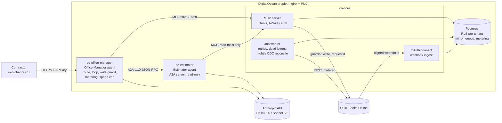
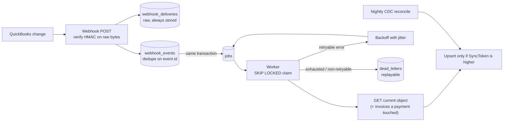

# Architecture

## System



**Agent-to-tool is MCP; agent-to-agent is A2A.** Both agents reach data only
through the MCP server, with the caller's API key, so tenant and scopes travel
with every hop: user → Office Manager → (A2A) → Estimator → (MCP) → data.

## Drafting an estimate

```mermaid
sequenceDiagram
  autonumber
  actor U as Contractor
  participant OM as Office Manager
  participant E as Estimator (A2A)
  participant M as MCP server
  participant Q as QuickBooks

  U->>OM: Draft an estimate for a bathroom remodel for Mark Johnson
  OM->>OM: route (Haiku 5.5): intent=estimate -> Sonnet 5.5
  OM->>M: find_customer("Mark Johnson")
  OM->>E: A2A message/send (job description, customer_id, parent_run_id)
  E->>M: get_customer_job_history(query, limit 20)
  E->>E: submit_estimate, validated in code: items and prices must come<br/>from retrieved jobs; amounts computed in code
  E-->>OM: artifact "estimate" (lines, assumptions, comparables)
  OM->>M: create_estimate_draft(lines) [step 1]
  M-->>OM: preview + single-use confirmation token (nothing written)
  OM-->>U: preview, assumptions, "approve?"
  U->>OM: Yes, create it
  OM->>OM: write guard: token shown in an earlier turn AND intent=approve_draft
  OM->>M: create_estimate_draft(confirmation_token) [step 2]
  M->>Q: POST /estimate?requestid=<fixed per draft>
  Q-->>M: Estimate
  M-->>OM: created (replaying the token returns the same estimate)
  OM-->>U: Created estimate #1041
```

## Keeping the mirror current



## Tenancy and security

- Postgres row-level security with `FORCE`, a non-owner app role, and a
  transaction-local tenant setting. Cross-tenant access only through
  `asSystem(reason)`, used where routing must happen before the tenant is known.
- QuickBooks tokens: AES-256-GCM with a versioned key ring and AAD binding each
  ciphertext to tenant, realm and column. Refresh under a row lock.
- MCP and agent API keys: 256-bit, stored as SHA-256; the app role can only
  resolve them through a `SECURITY DEFINER` function. No tool accepts a tenant id.
- Writes: two gates (MCP preview/token, agent runtime approval check), one fixed
  `requestid` per draft.
- Web chat: strict nonce-based CSP, key kept in `sessionStorage`, all agent
  output HTML-escaped before rendering.
